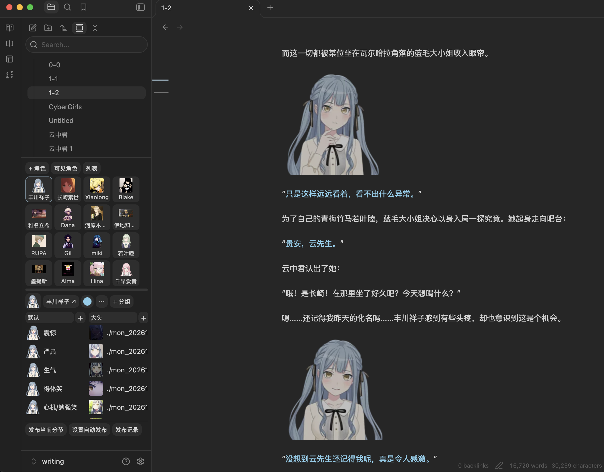

# obs-anker

在 Obsidian 中创作安科：管理多部作品和角色差分，用 Markdown 写作，将当前分节复制为 NGA BBCode 或发布到 NGA。

角色和正文都是 Vault 中的 Markdown 文件。一个角色一个文件，用标题管理差分组；笔记、附件、窗口布局和编辑历史沿用 Obsidian 的功能。



## 功能

- **项目与角色**：自动跟随当前文件识别作品，各项目拥有独立角色库；角色颜色、别名、头像和备注保存在 Markdown 属性中。
- **差分管理**：紧凑缩略图、悬停预览、可折叠分组、全文描述搜索，以及组内排序、跨组和跨角色拖动。
- **写作辅助**：NGA 骰子、对白上色／清色、中文引号配对、确认式 Tab 补全、半角标点转全角。
- **NGA 导出与发布**：Markdown 转 BBCode，按分割线识别分节；可手动发布当前分节或设置定时发布。

## 安装

支持 macOS 和 Windows，要求 **Obsidian 1.11.4 或更新版本**。macOS 已做实际使用验证；Windows 尚待实机验证。目前通过 GitHub 安装，社区插件目录审核通过后会更新此处。

1. 打开 [Releases](https://github.com/Eli-Ven/obs-anker/releases/latest)，下载 `obs-anker-0.1.3.zip`。
2. 解压后，将 `anke-writing` 文件夹放入你的 Vault 的 `.obsidian/plugins/`。
3. 在 Obsidian「设置 → 第三方插件」中启用 **obs-anker**。

更新时替换插件包中的文件，再停用并重新启用插件。保留已有的 `data.json`，它保存偏好和发布记录。插件文件夹名保持 `anke-writing`，以沿用现有设置和快捷键。

## 开始写作

1. 在 Vault 中创建一个作品文件夹。
2. 按 **Cmd/Ctrl+P**，运行 **anke init**，选中该文件夹。初始化保留已有文件。
3. 在角色面板点击「添加角色」，再用分组旁的「＋」添加差分。
4. 在作品目录下创建 `1-1 第一章.md`，开始写作；文件名识别规则和角色目录名都可在插件设置中修改。
5. 用独占一行的 `---` 分节，与上方正文隔一个空行。把光标放在目标分节里，按 **Option/Alt+C**，即可复制为 NGA BBCode。

```text
我的作品/
  我的作品.md       # 项目配置，由 anke init 创建
  1-1 第一章.md
  1-2 第二章.md
  角色/
    若叶睦.md       # 角色属性、差分和笔记
```

| 默认快捷键 | 功能 |
| --- | --- |
| Option/Alt+D | 插入 NGA 骰子 `[dice]1d100[/dice]` |
| Option/Alt+1～3 | 对应角色对白上色，再按一次清色 |
| Option/Alt+C | 复制选区／当前分节为 NGA BBCode |
| Cmd/Ctrl+Shift+P | 搜索差分并插入 |

所有命令都可在 Obsidian「快捷键」设置中重新绑定。

## 网络与数据

- 写作和角色文件保存在本地 Vault，角色管理与 BBCode 转换不要求 NGA 账号。
- 预览远程图片时会访问图片链接的主机；检查 NGA 图片尺寸及导出带尺寸图片时会匿名访问对应图片地址。
- 发布功能使用你主动保存的 NGA Cookie，向绑定帖子的 NGA 主机发送回复。Cookie 使用 Obsidian SecretStorage 保存；发布记录保存在插件配置中，包含已发送的正文。
- 定时发布只在指定执行设备的 Obsidian 运行时执行；错过的任务会提示处理。插件没有遥测，也不读取 Vault 外的个人文件。
- 本地图片可用于角色管理；发布到 NGA 前需自行上传到可访问的图床。插件目前不提供图片上传。

## 反馈

插件免费使用。欢迎通过 [Issues](https://github.com/Eli-Ven/obs-anker/issues) 提交问题或建议，请附上复现步骤、系统和 Obsidian 版本；不要附带 Cookie 或私密正文。

<a name="support"></a>

## 赞赏

插件免费使用。如果它对你的创作有帮助，欢迎用微信扫描下方赞赏码支持维护。金额随意，打赏完全自愿。


## 许可

代码采用 [MIT License](LICENSE)，允许使用、修改和再分发，需保留版权及许可声明。你的作品内容仍归你所有。第三方组件按各自许可证授权，详见[第三方许可](THIRD_PARTY_NOTICES.md)。
